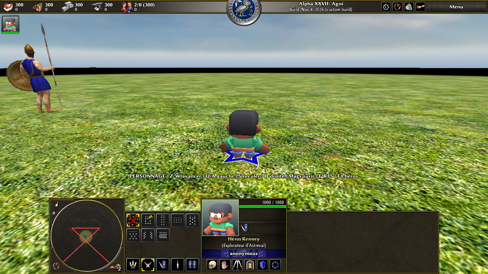

# Astreval — jeu vidéo construit dans le vrai code de 0 A.D.

Le projet modifie **Pyrogenesis et le mod public de 0 A.D.**, sans prototype Godot. La deuxième étape est disponible : un personnage 3D Kenney est jouable en vue à la troisième personne dans une petite carte de démonstration native. Le jeu de stratégie d'origine reste accessible.



## Jouer à l'étape 2

Dans le Codespace, le code 0 A.D. est dans `/workspaces/0ad`, branche `astreval/character-controls`, commit **`1d63fd04`**. L'exécutable release a été compilé dans `binaries/system/pyrogenesis`. Sur un ordinateur Linux doté d'un affichage graphique, après application des correctifs et compilation :

```sh
cd /workspaces/0ad
binaries/system/pyrogenesis -autostart=scenarios/astreval_first_steps
```

La carte **« Astreval — premiers pas »** contient le héros, deux alliés et deux adversaires éloignés. Pour la retrouver dans les menus, chercher son nom parmi les cartes *Scénarios*. Ce n'est pas encore une campagne ou un monde finalisé : le terrain plat sert de banc d'essai aux contrôles.

| Touche | Action |
| --- | --- |
| **F4** | Sélectionner son héros (ou une unité d'infanterie sur une autre carte) et cadrer la caméra TPS. |
| **Z / W** | Avancer dans la direction du personnage. |
| **Q / A**, **S**, **D** | Aller à gauche, reculer, aller à droite ; les diagonales sont normalisées. |
| **Maj** | Courir pendant un déplacement. |
| **F** | Basculer entre la caméra derrière l'unité et la caméra RTS d'origine. |

Le déplacement direct n'est actif que pour **une unité possédée et sélectionnée en mode TPS**. Relâcher les touches, changer de sélection, mettre en pause ou quitter le mode TPS arrête le personnage. La simulation, la collision et la recherche de chemin restent gérées par 0 A.D. : le client n'effectue aucune téléportation. Les commandes sont bornées en distance, limitées en fréquence et validées côté simulation.

> Le jeu natif n'est **pas une application jouable directement dans l'onglet navigateur** du Codespace. Les essais graphiques décrits ci-dessous ont été effectués sous Xvfb ; pour y jouer normalement, utiliser un affichage Linux/X11 ou un bureau distant configuré séparément.

## Ce qui est inclus

1. **Étape 1 — caméra TPS :** commit 0 A.D. `0572a783`, correctif [`patches/camera-tps.patch`](patches/camera-tps.patch). Caméra C++ interpolée derrière la première unité sélectionnée, bascule **F**, retour possible aux commandes RTS.
2. **Étape 2 — personnage et contrôles :** commit `1d63fd04`, correctif [`patches/character-controls.patch`](patches/character-controls.patch), à appliquer **après** l'étape 1. Raccourcis ZQSD/WASD et Maj, contrôleur GUI, commande réseau `character-move` validée côté simulation, sélection **F4**, carte de démonstration et modèle 3D Kenney.
3. **Personnage Kenney Mini Characters 1 :** GLB source et licence CC0 conservés dans `binaries/data/mods/public/art/source/kenney/` ; maillage skinné, squelette et six animations COLLADA importés par 0 A.D. : **Idle**, **Walk**, **Run** (clip `sprint`), **attack_melee**, **Death**, **Jump**. Le portrait provient du même GLB. Le clip *Jump* est préparé, mais **aucun saut jouable ni physique de saut n'a été ajouté**.

Les sources reproductibles de conversion et du portrait sont dans `tools/convert_kenney.py` et `tools/render_kenney_portrait.py` sur la branche 0 A.D. Blender **3.6 LTS** est requis pour réexporter en COLLADA (l'exporteur COLLADA n'est plus disponible dans le Blender 4.0.2 installé via Ubuntu). Les fichiers `.dae` prêts à l'emploi sont déjà fournis dans le correctif : Blender n'est **pas requis pour jouer**. La texture externe `colormap.png` doit se trouver à côté du GLB dans un sous-dossier `Textures/` lors d'une reconversion.

## Appliquer les correctifs à un clone propre

Les deux correctifs sont basés sur le même commit source 0 A.D. **`61a3b950`**. La branche déjà modifiée du Codespace ne doit pas recevoir une deuxième fois ces correctifs. Pour un clone neuf au commit indiqué :

```sh
cd /chemin/vers/0ad
git switch --detach 61a3b950
git switch -c astreval-jouable
git apply --check /chemin/vers/jeu-video/patches/camera-tps.patch
git apply /chemin/vers/jeu-video/patches/camera-tps.patch
git apply --check /chemin/vers/jeu-video/patches/character-controls.patch
git apply /chemin/vers/jeu-video/patches/character-controls.patch
```

Construire ensuite selon les [instructions de compilation officielles de 0 A.D.](https://gitea.wildfiregames.com/0ad/0ad/wiki/BuildInstructions). Le Codespace dispose déjà des dépendances, de SpiderMonkey et d'une version release compilée. Le patch de l'étape 2 inclut les fichiers binaires du GLB et des textures (`git apply` les gère).

## Vérifications réellement effectuées

- Compilation et édition de liens du moteur natif release : `pyrogenesis -version` affiche `Pyrogenesis 0.0.27`.
- Quatre tests Node dans le Codespace : `third_person_camera.test.js`, `character_controller.test.js`, `character_commands.test.js`, `character_assets.test.js` — tous réussis. Ils simulent l'API pour les contrôles et vérifient la structure des assets ; ils ne remplacent pas les essais en jeu.
- Démarrage natif non visuel de `scenarios/astreval_first_steps`, plus de 78 000 tours sans erreur lors d'un essai limité par `timeout`.
- Partie graphique réelle sous **Xvfb** et rendu logiciel : personnage et portrait affichés ; F4 sélectionne le héros ; W le déplace, Maj active la course, arrêt au relâchement ; aucun échec de chargement d'asset ni de script dans les journaux. Les seuls avertissements concernent le pilote logiciel `llvmpipe`.
- Correctif de l'étape 2 contrôlé en sens inverse sur son commit et en sens normal sur un index au commit `0572a783` ; copie de contrôle Git propre.

Pour lancer les tests fournis **dans ce Codespace**, où leurs chemins absolus pointent vers `/workspaces/0ad` :

```sh
cd /workspaces/jeu-video
node tests/third_person_camera.test.js
node tests/character_controller.test.js
node tests/character_commands.test.js
node tests/character_assets.test.js
```

## Ressources, droits et suites possibles

- **Kenney, Mini Characters 1** : source [Kenney](https://kenney.nl/assets/mini-characters) / [OpenGameArt](https://opengameart.org/content/mini-character-1), **CC0** (licence originale incluse). C'est le **seul pack externe effectivement intégré** à l'étape 2.
- **Mixamo** : personnages et animations utilisables dans des jeux suivant les [conditions Adobe](https://helpx.adobe.com/creative-cloud/faq/mixamo-faq.html) ; compte Adobe et droits distincts du CC0. Rien d'importé.
- **Poly Haven** : [ressources CC0](https://polyhaven.com/license), dont textures et décors possibles pour une prochaine carte. Rien d'importé.
- **Sketchfab** : [licence et attribution à vérifier modèle par modèle](https://sketchfab.com/developers/download-api/guidelines) ; rien d'importé.
- **OpenGameArt** : licences variables selon la ressource ; le pack Kenney ci-dessus est CC0. Les autres packs repérés (*Fantasy Town Kit*, *Mini Dungeon*) ne sont pas intégrés.

Le code de 0 A.D. et ses modifications restent sous **GPL-2.0-ou-ultérieure** (copie dans [`licenses/GPL-2.0.txt`](licenses/GPL-2.0.txt)) ; les assets historiques de 0 A.D. portent leurs propres licences. Le personnage Kenney et ses fichiers dérivés sont **CC0**. Les combats natifs demeurent pilotés par le système d'ordres de 0 A.D. : il reste à créer le véritable monde, les bâtiments, les quêtes et d'éventuelles commandes de combat/saut propres au personnage.
