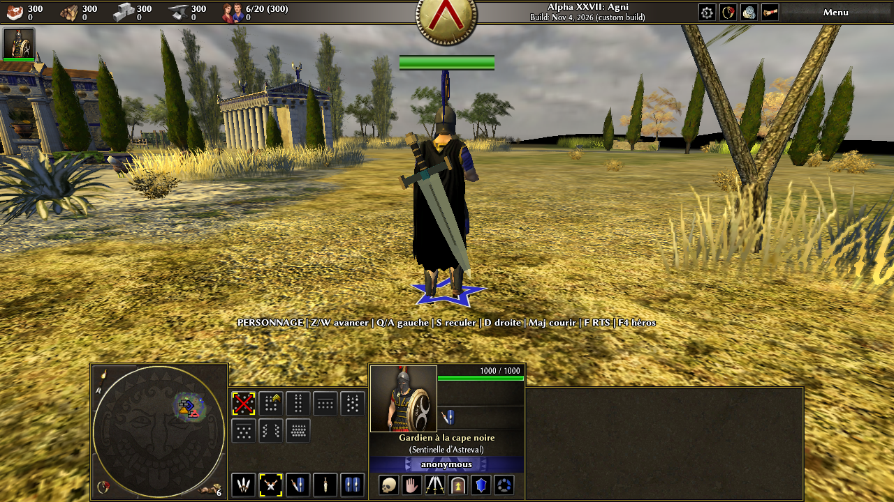

# Astreval — héros à cape noire dans le vrai 0 A.D.

**Le petit personnage Kenney a été remplacé.** Le protagoniste est désormais un **humain aux proportions de 0 A.D.**, portant une armure sombre, un casque, une **cape noire animée** et une **grande épée 3D en diagonale dans le dos**. Il reste jouable en vue à la troisième personne dans le moteur natif Pyrogenesis ; la caméra RTS et le reste du jeu fonctionnent toujours.



## Essayer le héros

Dans le Codespace du projet, le code source 0 A.D. est sous `/workspaces/0ad`, branche **`astreval/hero-black-cape`**, commit **`ba12e471`** ; une version release du moteur a été compilée. Sur une machine Linux avec affichage graphique, une fois le correctif appliqué et le moteur compilé :

```sh
cd /workspaces/0ad
binaries/system/pyrogenesis -autostart=scenarios/astreval_arcadia
```

Cette version **« Astreval — Gardien noir d’Arcadie »** reprend le paysage, les bâtiments et les armées de la carte 0 A.D. *Arcadia* sans modifier l'original : une unité alliée y est remplacée par le héros, placé à l'écart de la foule pour que la cape et l'épée soient visibles. La carte plus simple `scenarios/astreval_first_steps` reste disponible pour tester les contrôles sur un terrain plat.

| Touche | Effet |
| --- | --- |
| **F4** | Sélectionner le héros et attacher la caméra derrière lui. |
| **Z / W** | Avancer selon l'orientation du personnage. |
| **Q / A**, **S**, **D** | Aller à gauche, reculer, aller à droite. |
| **Maj** | Courir pendant le déplacement. |
| **F** | Alterner entre caméra du personnage et caméra RTS classique. |

Le déplacement ne commande qu'une unité sélectionnée et possédée, en mode TPS. Relâcher les touches, changer de sélection ou mettre en pause l'arrête. Les diagonales sont normalisées ; la commande réseau `character-move` est limitée en fréquence et validée **dans la simulation** (propriété, type d'entité, coordonnées et distance). La collision et le cheminement restent ceux de 0 A.D., sans téléportation.

> Ce moteur natif **n'est pas directement jouable dans l'onglet web du Codespace**. Les captures et essais graphiques ont été réalisés sous Xvfb ; pour jouer normalement, il faut un affichage Linux/X11 ou un bureau distant configuré à part.

## Installation rapide : correctif final unique

Le correctif recommandé **[`patches/astreval-complete.patch`](patches/astreval-complete.patch)** part du commit source 0 A.D. **`61a3b950`** et installe directement la version finale **sans aucun asset Kenney**. Il inclut le moteur/caméra, les contrôles, le héros humain, sa grande épée et les deux cartes de démonstration.

```sh
cd /chemin/vers/0ad
git switch --detach 61a3b950
git switch -c astreval-jouable
git apply --check /chemin/vers/jeu-video/patches/astreval-complete.patch
git apply /chemin/vers/jeu-video/patches/astreval-complete.patch
```

Ne **pas** réappliquer ce correctif dans le Codespace déjà modifié. Pour compiler un clone neuf, suivre les [instructions officielles de 0 A.D.](https://gitea.wildfiregames.com/0ad/0ad/wiki/BuildInstructions). L'exécutable compilé dans le Codespace n'est pas un binaire distribué sur GitHub.

Les correctifs historiques, si l'on veut reconstruire les étapes séparément, sont [`camera-tps.patch`](patches/camera-tps.patch) → [`character-controls.patch`](patches/character-controls.patch) → [`hero-black-cape.patch`](patches/hero-black-cape.patch). **Le patch intermédiaire contient encore Kenney ; le troisième le retire.** Sur un clone neuf, préférer le correctif final unique ci-dessus, vérifié sur l'index du commit de base.

## Modèle, animations et limites

Le corps skinné, le visage, le casque, l'armure noire et les grèves proviennent des **assets humains existants de 0 A.D.** La longue cape noire utilise l'acteur animé `props/units/capes/cape_long_black.xml`. L'épée géante est un **nouveau maillage 3D** avec texture acier/or/cuir et attache sur le dos. Son générateur source est dans `tools/build_astreval_greatsword.py` (Blender 3.6 LTS ; Blender n'est **pas nécessaire pour jouer**, car le `.dae` et la texture sont inclus). La carte paysagée dérivée d'Arcadia peut être recréée avec `tools/make_astreval_arcadia.py`.

Les animations humaines de 0 A.D. assurent l'attente, la marche, la course, l'attaque et la mort ; la cape suit les mouvements. **L'épée reste visuellement fixée dans le dos** : il n'y a pas encore de dégainage personnalisé ni d'attaque spéciale à la grande épée. Le saut jouable n'a pas non plus été ajouté. Le projet est une étape de personnage/contrôles, pas encore un monde ou une campagne achevée.

## Vérifications effectuées dans le Codespace

- Moteur 0 A.D. **compilé et réédité** après le réglage de caméra ; `pyrogenesis -version` indique `Pyrogenesis 0.0.27`.
- **Quatre tests Node** réussis : caméra, contrôleur, validation des ordres de simulation, assets du héros humain et cartes.
- Deux parties natives non visuelles : `astreval_first_steps` (environ **49 000 tours**) et `astreval_arcadia` (environ **9 800 tours**), sans erreur dans les journaux pendant les essais limités en temps.
- Essai graphique réel sous **Xvfb** : F4 sélectionne le nouveau héros, cape et épée s'affichent, la marche et la course fonctionnent sur les deux cartes ; aucun échec de chargement d'asset. Seuls avertissements : rendu logiciel `llvmpipe`.
- [`hero-black-cape.patch`](patches/hero-black-cape.patch) validé dans les deux sens (ancien/nouveau commit). Le **correctif complet** est également vérifié en sens normal sur la base `61a3b950` et en sens inverse sur le commit final.

Dans **ce Codespace**, où les tests visent les chemins `/workspaces/0ad` et `/workspaces/jeu-video` :

```sh
cd /workspaces/jeu-video
for test in tests/*.test.js; do node "$test"; done
```

## Droits et provenance

Le code modifié de 0 A.D. reste sous **GPL-2.0-ou-ultérieure** ; les assets historiques de 0 A.D. (armure, cape, animations, textures, portrait) relèvent de la licence indiquée dans le [`LICENSE.txt` de 0 A.D.](licenses/0ad-LICENSE.txt) et sa [licence spécifique aux éléments graphiques](licenses/0ad-art-LICENSE.txt), notamment **CC BY-SA 3.0** pour l'art. Attribution : **Wildfire Games**, [wildfiregames.com](https://www.wildfiregames.com/) ; [CC BY-SA 3.0](https://creativecommons.org/licenses/by-sa/3.0/). La carte paysagée est une adaptation de leur scénario *Arcadia* ; l'original est conservé. Les nouveaux fichiers d'art de l'épée sont distribués avec les fichiers du mod sous les mêmes conditions CC BY-SA 3.0. Le texte GPL est également copié dans [`licenses/GPL-2.0.txt`](licenses/GPL-2.0.txt).

Kenney, Mixamo, Poly Haven, Sketchfab et OpenGameArt ont été considérés lors de l'étape précédente, mais **aucun modèle externe n'est requis ou intégré au héros final**. En particulier, le personnage Kenney et sa licence CC0 n'apparaissent plus dans le correctif complet ni dans la branche actuelle ; seul le correctif historique de l'étape 2 garde la trace de cette première expérimentation.
