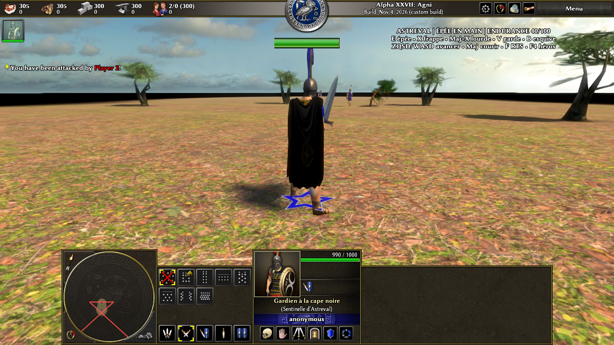
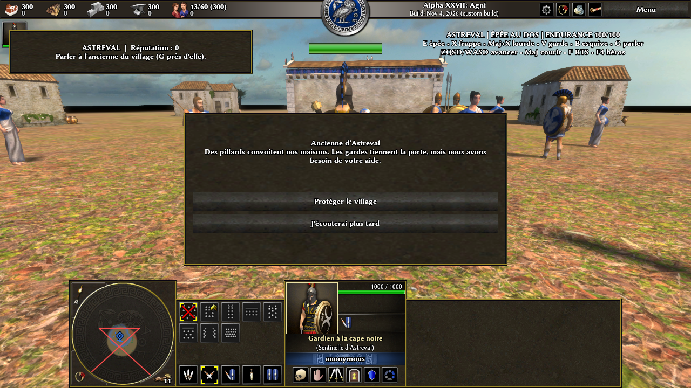

# Astreval — villages, quête et combat HD dans le vrai 0 A.D.

Astreval est développé **dans le code natif 0 A.D./Pyrogenesis**, pas dans Godot. Le héros est un humain au style du jeu, en armure sombre, avec une cape noire et une grande épée : l’épée s’attache au dos ou à la main selon son état, et le combat utilise la simulation native de 0 A.D. Le rendu peut être configuré jusqu’à **3840×2160**, avec un profil plus léger. Sur Arcadie et sur une nouvelle carte, le héros visite les villages, parle aux habitants, choisit une quête et affronte ou négocie avec un chef rival ; les troupes restent commandables depuis la vue RTS.





## Accéder à la version en cours

- **Codespace avec le véritable dépôt source 0 A.D. :** [ouvrir le Codespace](https://jeu-vid-o-5g6vqv5wq5jxh794r.github.dev), `/workspaces/0ad`, branche **`astreval/village-rts-quests`**, commit **`a0f37f40`** (l’étape HD/combat reste accessible via `astreval/4k-sword-combat`, `2200f531`).
- Ce dépôt compagnon publie le **correctif incrémental complet, avec ses assets binaires** : [`patches/astreval-4k-combat.patch`](patches/astreval-4k-combat.patch). Il s’applique **après** le correctif jouable de l’étape précédente [`patches/astreval-complete.patch`](patches/astreval-complete.patch). Le premier correctif intermédiaire n’est pas un remplacement de la base. **Nouvelle étape :** appliquer ensuite [`patches/astreval-village-phase4.patch`](patches/astreval-village-phase4.patch), qui contient les deux cartes, les déclencheurs, le HUD et les tests Node. Voir le [guide des villages et quêtes](docs/ASTREVAL_VILLAGE_RTS_QUESTS.md).
- Les fichiers 3D et textures finaux sont inclus dans le correctif. **Pas besoin de Blender, Pillow ni d’un service externe pour jouer.** Le Codespace web, à lui seul, ne diffuse pas la fenêtre graphique 3D : il faut un affichage Linux/X11 ou un bureau distant.

Sur une copie propre des sources 0 A.D. au commit `61a3b950` :

```sh
cd /chemin/vers/0ad
git switch --detach 61a3b950
git switch -c astreval-hd-combat
git apply --check /chemin/vers/jeu-video/patches/astreval-complete.patch
git apply /chemin/vers/jeu-video/patches/astreval-complete.patch
git apply --check /chemin/vers/jeu-video/patches/astreval-4k-combat.patch
git apply /chemin/vers/jeu-video/patches/astreval-4k-combat.patch
git apply --check /chemin/vers/jeu-video/patches/astreval-village-phase4.patch
git apply /chemin/vers/jeu-video/patches/astreval-village-phase4.patch
```

Ne **pas** réappliquer ces trois correctifs dans le Codespace déjà modifié. Pour reconstruire l’exécutable sur une autre machine, voir les [instructions officielles 0 A.D.](https://gitea.wildfiregames.com/0ad/0ad/wiki/BuildInstructions). Les anciens correctifs `camera-tps.patch`, `character-controls.patch` et `hero-black-cape.patch` restent archivés comme étapes historiques, **sans être nécessaires** si l’on utilise les deux correctifs ci-dessus.

## Jouer et choisir sa qualité

À partir de la racine 0 A.D. dans un environnement graphique Linux :

```sh
python3 tools/play_astreval.py --quality balanced --map astreval_village
python3 tools/play_astreval.py --quality balanced --map astreval_duel
python3 tools/play_astreval.py --quality cinematic --map astreval_arcadia
python3 tools/play_astreval.py --quality performance --resolution 3840x2160
```

| Profil | Usage |
|---|---|
| `cinematic` | Sortie 3840×2160, acteur HD, textures de qualité maximale, anisotropie ×16, éclairage/ombres avancés et anti-crénelage MSAA4. GPU récent conseillé. |
| `balanced` | Résolution de l’écran, modèle plus léger, FXAA et ombres modérées. Profil du test visuel réel. |
| `performance` | Sortie jusqu’à 3840×2160 mais rendu interne à 75 % avec mise à l’échelle FSR, détails/ombres allégés. Dépend des capacités du GPU. |

`--resolution 1920x1080`, `--resolution 3840x2160`, `--map astreval_first_steps` ou `--backend vulkan` sont également acceptés par le lanceur ; **Vulkan et le débit d’images en vraie 4K n’ont pas été validés sur une carte graphique physique**. Ces réglages n’altèrent pas la configuration personnelle du jeu. `--dry-run` affiche la commande au lieu de lancer le moteur.

| Touche | Effet |
| --- | --- |
| **F4** | Sélectionner le héros et suivre ses mouvements en TPS. |
| **ZQSD / WASD**, **Maj** | Marcher, courir, se déplacer en diagonale. |
| **F** | Basculer TPS du héros / caméra RTS native pour commander les troupes. |
| **G** | Parler à un habitant proche en TPS, puis choisir une réponse. |
| **E** | Dégainer ou ranger la grande épée sur le dos. |
| **X**, **Maj+X** | Coup léger, ou coup lourd plus coûteux. Trois frappes légères en rythme forment un petit enchaînement. |
| **V maintenu** | Garde frontale ; la parade est plus efficace juste après la mise en garde. |
| **B** | Esquive directionnelle (repli en l’absence de touche de direction). |

L’interface déplace les instructions en haut à droite et affiche l’endurance/l’état de l’épée. **La simulation** valide la propriété du héros, les cooldowns, la portée, la cible, le cône de garde, la résistance, l’endurance et les dégâts ; les ordres du client ne peuvent ni choisir arbitrairement les dégâts ni téléporter le héros. L’esquive emploie le pathfinding et les collisions natives. Les coups reposent sur les animations à deux mains existantes de 0 A.D.

## Deux villages et une quête à conséquences

Sur **Arcadie** et sur la carte **`astreval_village`**, parlez à l’ancienne (G) : défendez les maisons contre trois pillards, laissez les gardes protéger les abords et les éclaireurs reconnaître le village rival. Les ordres RTS manuels priment 35 secondes sur les routines. Aider les habitantes accroît votre réputation ; un rapport du guide ouvre la rencontre avec le chef rival, puis le choix entre duel 1v1 et trêve (réputation 4). L’étoile sous le héros est la surbrillance native 0 A.D. : cachée en TPS, visible en RTS.

Les **deux cartes ont chargé dans Pyrogenesis** sous Xvfb/llvmpipe en 1280×720 ; dialogue et premier choix constatés sur les deux, raid repoussé et progression jusqu’au rapport observés sur la nouvelle carte. Deux tests Node vérifient aussi les branches de duel et trêve ; **le duel complet n’a pas encore été joué de bout en bout dans le moteur, ni la sauvegarde/reprise de la quête**. Voir les [captures du village](screenshots/astreval-village-report.png) et le [détail technique](docs/ASTREVAL_VILLAGE_RTS_QUESTS.md).

## Ce qui est réellement HD — et ses limites

Le héros possède des variantes : cape noire **2048×4096**, armure **2048²** et épée **2048²** avec diffuse, normales et spéculaire ; la version légère emploie les textures originales. La prairie des cartes de démonstration utilise un scan authentique **4096²** de *Leafy Grass* de **Charlotte Baglioni / Poly Haven** (CC0), transformé en DDS BC1 **avec mipmaps** pour être décodable par Pyrogenesis. L’armature, les attaches `quiver_back` et `weapon_R` ainsi que les animations sont celles de 0 A.D. ; les deux maillages COLLADA de l’épée sont intégrés. Voir le [guide technique détaillé](docs/ASTREVAL_4K_COMBAT.md).

**Limites honnêtes :** les autres soldats et l’ensemble des milliers de décors de la grande carte *Arcadia* demeurent des assets 0 A.D. natifs ; ils n’ont pas tous une nouvelle texture 4K ni une nouvelle géométrie. La dégaine, la roulade et une prise à deux mains dédiées n’ont pas encore d’animation originale : l’équipement change de point d’attache et les attaques réutilisent les animations 0 A.D. Les deux petites cartes de test sont volontairement simples et peuvent laisser apparaître une bande sombre à l’horizon. Ce n’est pas encore une direction artistique 4K entièrement finalisée.

## Tests réalisés et références consultées

- **Trois cartes** simulées dans le vrai moteur sans erreur de journal : `astreval_duel` (9 247 tours), `astreval_first_steps` (14 824 tours), `astreval_arcadia` (2 024 tours) lors du dernier cycle chronométré. Test Node `tools/test_astreval_combat.js` : équipement, parade directionnelle, esquive, enchaînement, coup lourd, raté et endurance réussis. Les assets XML ont été analysés.
- Essai **graphique** dans 0 A.D. sous Xvfb/llvmpipe à **1280×720** : textures DDS corrigées, prairie visible, cape, épée passant effectivement du dos à la main, adversaire, garde/esquive/endurance ; aucune erreur de décodage dans le journal. Le profil cinématique à 720p se lance sans erreur mais le rendu logiciel met longtemps à finaliser l’image. **Aucun benchmark 3840×2160 sur GPU n’a été fait.**
- Méthodes étudiées : [combat natif 0 A.D.](https://gitea.wildfiregames.com/0ad/0ad/wiki/Manual_BasicGameplay), [Alpha 27 (Vulkan, FSR, skin GPU)](https://play0ad.com/new-release-0-a-d-alpha-27-agni/), [guide communautaire Blender/COLLADA](https://wildfiregames.com/forum/topic/17842-how-to-export-animations-from-blender3d-to-0ad/), [licence Poly Haven](https://polyhaven.com/license). L’approche réutilise les composants et animations natifs, **pas du code tiers copié**.

## Licences

Le code 0 A.D. et ses adaptations restent sous **GPL-2.0-ou-ultérieure** ; les arts 0 A.D. historiques et leurs adaptations sont crédités à **Wildfire Games** suivant [les conditions graphiques 0 A.D.](licenses/0ad-art-LICENSE.txt), notamment **CC BY-SA 3.0**. La prairie Poly Haven est **CC0 1.0**, provenance détaillée dans `art/source/astreval/LEAFY_GRASS_LICENSE.txt` du correctif. Le personnage Kenney du prototype n’a **pas** été réintroduit. Le texte de la GPL est conservé dans [`licenses/GPL-2.0.txt`](licenses/GPL-2.0.txt).
